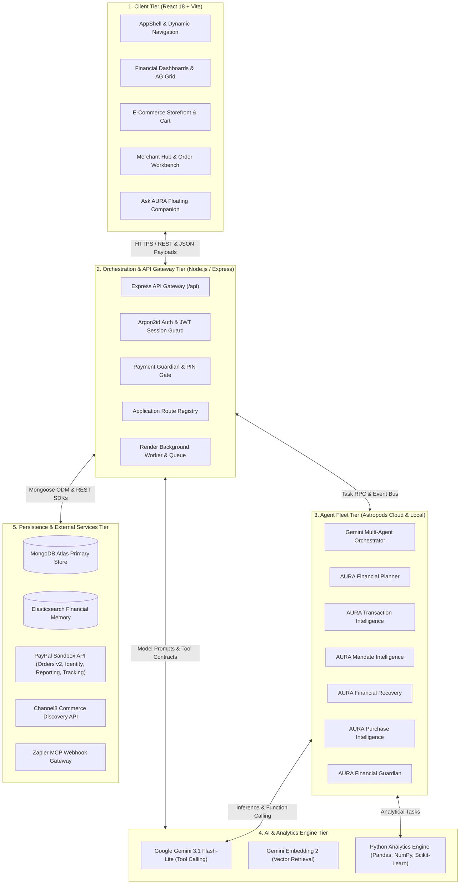
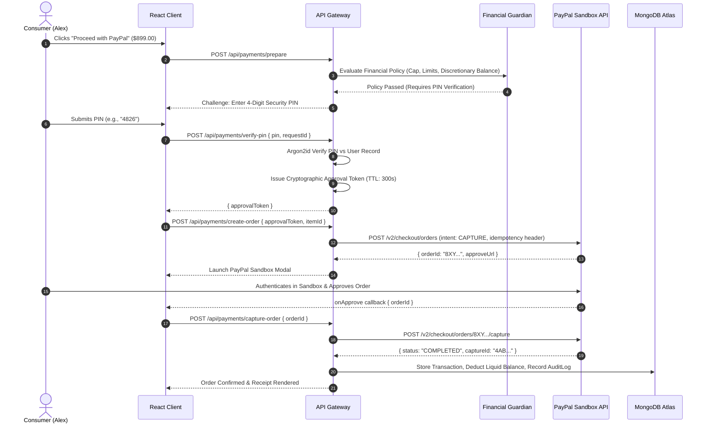
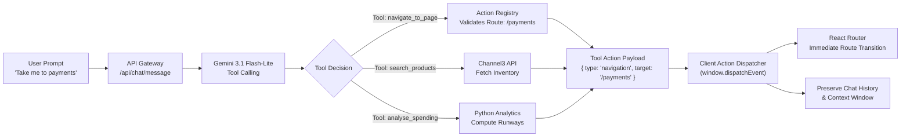
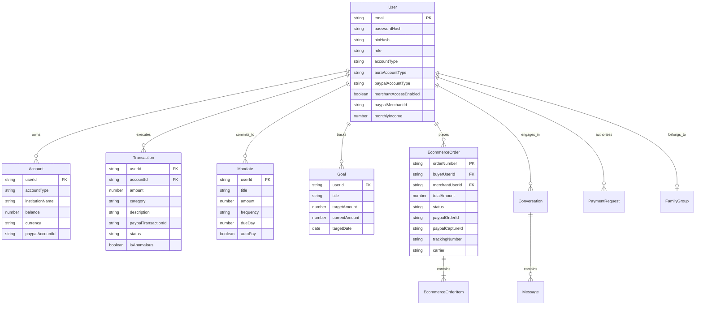

# AURA: System Architecture & Technical Engineering Specification

> **Autonomous Unified Resource Assistant (AURA)**  
> *Architectural Blueprint, State Machines, Data Models & Integration Protocols*

---

## 1. Architectural Philosophy & Core Principles

AURA is engineered around three non-negotiable architectural axioms:

1. **Deterministic Financial Safety:** Non-deterministic large language models (LLMs) must **never** execute financial mutations or disburse funds directly. AI agents may discover products, analyze liquidity, forecast goal delays, and prepare transaction structures—but execution requires an immutable **user-in-the-loop** authorization boundary backed by Argon2id PIN verification and cryptographic approval tokens.
2. **Authoritative Transactional Truth:** MongoDB Atlas is the sole authoritative state of truth for account balances, transaction records, recurring commitments, and order states. External search indexes (Elasticsearch) and client-side grids (AG Grid) are derived consumers that reflect validated backend states.
3. **Resilient Graceful Degradation:** Every external sponsor service and API integration (PayPal Sandbox, Google Gemini, Channel3, Astropods, Elastic, KERNEL, Zapier) incorporates deterministic local fallbacks, in-memory caches, or offline reference models to ensure 100% platform availability even during upstream API degradation.

---

## 2. High-Level 5-Tier Architecture

The platform is organized into five decoupled tiers:

---

## 3. Detailed Tier Specifications

### 3.1 Client Tier (Presentation & Interaction)
* **Framework:** React 18.3.1 with TypeScript 5.6, bundled via Vite 5.4.
* **Styling & Theming:** Tailwind CSS 3.4 with unified Dark/Light mode tokens and persistent `localStorage` preference tracking.
* **Data Grids:** AG Grid Community v32.3 integrated with custom cell renderers for status badges, category filters, and currency formatting.
* **Data Visualization:** Recharts for cash flow projections, monthly category pacing, and goal milestone timelines.
* **State & Communication:** React Context providers (`AuthContext`, `AskAuraContext`) managing token persistence, real-time client-side navigation (`navigate_to_page` action dispatching), and active order tracking drawers.

### 3.2 Orchestration & API Gateway Tier
* **Runtime:** Node.js 20+ with Express 4.21 and TypeScript (`tsx` runtime in development).
* **Security Middleware:** 
  * `helmet` for secure HTTP headers.
  * `cors` with origin whitelisting (`CLIENT_ORIGIN` and Onrender hosts).
  * `express-rate-limit` enforcing strict rate limiting on authentication and AI endpoints.
  * `argon2` implementing Argon2id password hashing and payment PIN verification.
  * `jsonwebtoken` issuing HMAC-SHA256 session tokens with 24-hour expiration.
* **Worker Service:** In-process durable background scheduler executing daily commitment evaluations, bill reminders, and retry queues.

### 3.3 Agent Fleet Tier (Astropods Framework)
AURA partitions complex financial operations into six specialized micro-agents:
1. **`financial-planner`:** Computes 50/30/20 budget allocations, savings rates, and emergency fund runway.
2. **`transaction-intelligence`:** Analyzes spending velocity, flags statistical anomalies, and categorizes transaction streams.
3. **`mandate-intelligence`:** Infers recurring bills, monitors subscription price changes, and prevents duplicate memberships.
4. **`financial-recovery`:** Detects budget overruns and formulates non-judgmental expense adjustments to protect essential obligations.
5. **`purchase-intelligence`:** Evaluates product affordability against liquid balances and calculates days delayed for active savings goals.
6. **`financial-guardian`:** Enforces hard financial policies (daily limits, single-transaction caps) and gates payment preparation. **Invariant:** `canExecutePayments: false`.

### 3.4 AI & Analytics Engine Tier
* **Google Gemini 3.1 Flash-Lite:** Primary conversational and tool-dispatching LLM. Generates function-call arguments formatted against Zod schemas.
* **Google Gemini Embedding 2:** Semantic vector generation for product catalog matching and conversational context retrieval.
* **Python Analytics Microservice (`analytics_engine.py`):**
  * Invoked via Node.js `child_process.spawn` over an asynchronous JSON stdin/stdout pipe.
  * Implements `scikit-learn` IsolationForest for transaction anomaly detection.
  * Computes exponential moving average cash flow forecasts and discretionary budget ceilings.
  * Execution timeout: 1,500ms with instantaneous fallback to deterministic TypeScript mathematics.

### 3.5 Persistence & External Services Tier
* **MongoDB Atlas:** Multi-region cluster maintaining 18 relational document collections.
* **PayPal Sandbox REST Ecosystem:**
  * Orders v2 (`POST /v2/checkout/orders`, `POST /v2/checkout/orders/{id}/capture`).
  * Identity API (`POST /v1/oauth2/token`, `GET /v1/identity/openidconnect/userinfo`).
  * Reporting API (`GET /v1/reporting/transactions`, `GET /v1/reporting/balances`).
  * Webhook Receiver (`POST /api/webhooks/paypal`).
  * Shipment Tracking API (`POST /v1/shipping/trackers-batch`).
* **Channel3 API:** Live e-commerce querying, seller ratings, multi-merchant offer extraction, and stock status tracking.

---

## 4. Key Execution Workflows & State Machines

### 4.1 Payment Creation, Verification & Capture State Machine

### 4.2 Ask AURA Autonomous Tool Execution Pipeline

---

## 5. Database Schema & Entity Relationships

---

## 6. Security Architecture & Boundary Controls

1. **Authentication:** Argon2id hash parameters configured with time cost = 3, memory cost = 65,536 KiB, and parallelism = 4.
2. **Payment Authorization Gate:**
   * Step 1: Pre-flight financial policy verification (`PaymentGuardianService`).
   * Step 2: In-band user PIN verification returning a signed JWT approval token with 300-second TTL.
   * Step 3: Orders v2 creation executed server-side using authorized PayPal client credentials.
3. **Idempotency Protection:** Every order creation and capture sends a unique `PayPal-Request-Id` header (UUIDv4) preventing duplicate debit charges under network replay scenarios.
4. **Data Isolation:** Every MongoDB query enforces strict `{ userId: req.user.id }` scope constraints, preventing cross-tenant data access. Family group members share only household-tagged budgets while individual account numbers and transactions remain private.
5. **Webhook Integrity:** Inbound PayPal webhooks are validated using PayPal's public key transmission certificates via `/v1/notifications/verify-webhook-signature` before triggering order fulfillment.

---

## 7. Resilience & Graceful Degradation

| Subsystem | Primary Integration | Failure Scenario | Fallback Mechanism |
| :--- | :--- | :--- | :--- |
| **Conversational AI** | Google Gemini 3.1 Flash-Lite | API rate limit / 429 quota exhaustion | Fallback to heuristic intent parser + cached responses |
| **Product Discovery** | Channel3 Commerce API | Network timeout / invalid API key | Curated verified reference catalog with realistic pricing |
| **Transaction Analytics** | Python ML (`analytics_engine.py`) | Python runtime missing / execution timeout | Instantaneous TypeScript statistical algorithm fallback |
| **Multi-Agent Fleet** | Astropods Cloud Deployments | Container offline / adapter unreachable | Local TypeScript agent logic executed within Node.js process |
| **Search & Indexing** | Elasticsearch Cluster | Cluster unreachable / connection refused | Direct MongoDB regex queries + persistent sync retry queue |
| **Payment Execution** | PayPal Sandbox API | Sandbox platform latency | Exponential backoff retry with idempotent transaction keys |

---
*Document Version: 2.1.0 | AURA Technical Engineering Documentation*
