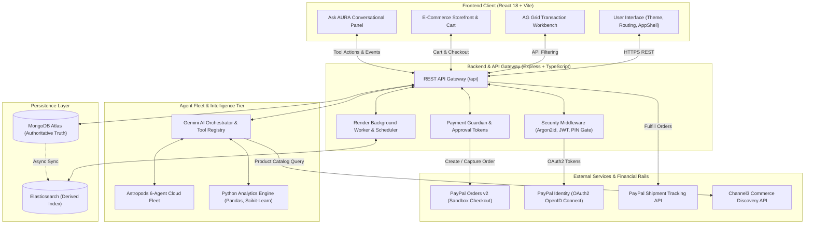

# AURA: Autonomous Understanding & Resource Allocation

> **Your Money. Your Goals. Your Decisions.**  
> *The AI-Powered Financial Co-Pilot & Autonomous Commerce Platform.*

[](https://developer.paypal.com)
[](https://ai.google.dev)
[](https://react.dev)
[](https://nodejs.org)
[](https://www.mongodb.com)
[](https://www.ag-grid.com)
[](LICENSE)

---

## 📑 Table of Contents

- [A. Project Introduction](#a-project-introduction)
- [B. The Problem](#b-the-problem)
- [C. Our Solution](#c-our-solution)
- [D. Key Features](#d-key-features)
- [E. Artificial Intelligence Architecture](#e-artificial-intelligence-architecture)
- [F. Technology Stack](#f-technology-stack)
- [G. System Architecture](#g-system-architecture)
- [H. Integrations & Partner Technologies](#h-integrations--partner-technologies)
- [I. Core End-to-End Workflows](#i-core-end-to-end-workflows)
- [J. Security, Privacy & Safety Boundaries](#j-security-privacy--safety-boundaries)
- [K. Installation & Local Development](#k-installation--local-development)
- [L. Environment Variables](#l-environment-variables)
- [M. API Documentation](#m-api-documentation)
- [N. Deployment Guide](#n-deployment-guide)
- [O. Project Structure](#o-project-structure)
- [P. Current Limitations & Roadmap](#p-current-limitations--roadmap)
- [Q. Contributors & Acknowledgements](#q-contributors--acknowledgements)
- [R. License](#r-license)

---

## A. Project Introduction

**AURA (Autonomous Unified Resource Assistant)** is an enterprise-grade financial co-pilot and agentic commerce platform built for the **PayPal + AI Hackathon**. 

Traditional personal finance applications are fundamentally backward-looking: they categorize transactions days after money has been spent, display retrospective charts, and issue post-facto budget reprimands. At the same time, modern e-commerce platforms operate with an opposing incentive: eliminating friction to encourage impulse checkouts, completely detached from the shopper's real-time savings goals, upcoming debt commitments, or monthly discretionary cash flow.

**AURA bridges this divide.** Powered by the **PayPal Developer Platform (Sandbox)**, **Google Gemini 3.1 Flash-Lite**, an autonomous **Astropods 6-agent fleet**, and a **Python predictive machine learning engine**, AURA accompanies consumers through the complete decision lifecycle:
1. **Understands:** Aggregates bank balances, liquid cash, fixed commitments, and long-term savings goals into a unified real-time model.
2. **Discovers:** Autonomously queries verified merchant catalogs via Channel3 based on natural-language search intent.
3. **Simulates:** Calculates mathematical consequences before money leaves the account (e.g., *"Purchasing this $899 laptop delays your Emergency Fund goal by 12 days, but fits within your monthly discretionary budget"*).
4. **Executes:** Completes secure, user-authorized checkouts via the **PayPal Orders v2 API** while adhering to a strict **user-in-the-loop** spend policy.
5. **Fulfills:** Connects buyers to merchants via a dedicated **Merchant Hub**, where sellers manage inventory, review orders, and inject tracking numbers into PayPal's shipment ecosystem.

> *“Personal finance tools show you what happened. AURA helps you decide what happens next.”*

---

## B. The Problem

Every day, consumers make consequential purchasing decisions in a vacuum, burdened by five persistent challenges:

1. **Fragmented Financial Realities:** Liquid checking accounts, high-yield savings, credit card balances, and PayPal wallets reside in separate silos, making accurate liquidity assessment tedious and inaccurate.
2. **Retroactive Spending Feedback:** Bank statements and budgeting apps inform users of overspending only after transactions have settled, when corrective action is impossible.
3. **Hidden Subscription & Commitment Creep:** Fixed monthly obligations (rent, insurance, recurring streaming services, loan EMIs) are scattered across different payment schedules, leading to accidental overdrafts and depleted savings.
4. **Context-Free E-Commerce:** Online shopping carts urge shoppers to *"Buy with 1-Click"* without evaluating whether an item compromises next month’s mortgage payment or long-term financial security.
5. **Context-Switching Fatigue:** Answering the simple question *"Can I afford this right now?"* requires toggling between bank applications, budgeting spreadsheets, price comparison tools, and shopping portals.

---

## C. Our Solution

AURA unifies proactive financial intelligence, product discovery, predictive impact analysis, and controlled payment execution into a singular platform:

* **Real-Time Financial Baseline:** Continuously computes available discretionary capital by deducting confirmed monthly obligations and active savings pace from total liquid assets.
* **Agentic Commerce Search:** Automatically searches and compares electronics, home goods, and appliances using the Channel3 live commerce API, filtering products by price, merchant rating, and technical specifications.
* **7-Factor Affordability Engine:** Evaluates proposed purchases against emergency cash runways, discretionary spending limits, category budgets, and savings goal velocities, outputting unambiguous guidance tiers.
* **Strict User-in-the-Loop Checkout:** AI agents prepare transactions, but cannot execute payments autonomously. Disbursing funds requires explicit in-band Argon2id PIN entry, cryptographic approval token issuance, and PayPal Sandbox modal authorization.
* **Two-Sided Marketplace Symmetry:** Integrates both consumer financial management and merchant fulfillment: consumer purchases flow immediately into the **Merchant Hub**, where sellers fulfill orders and trigger PayPal tracking updates.

---

## D. Key Features

The features documented below reflect the verified, working implementation in the codebase:

### 1. Authentication & Dual-Mode Profiles (Fully Implemented)
* **Local & PayPal Identity Authentication:** Supports standard email/password authentication (Argon2id hashing) and official **Log in with PayPal (OAuth2 OpenID Connect)**.
* **Dual Operating Modes:** Toggle seamlessly between **Personal Account** (household budgeting, goals, smart shopping) and **Business Account** (Wayne Enterprises Merchant Hub, order workbench, sales analytics).
* **Payment Security PIN:** Separate 4-digit security PIN hashed with Argon2id, required to issue 300-second cryptographic approval tokens for payments.
* **Pre-Seeded Hackathon Personas:** Fast-switching demo personas for evaluation: *Alex Sharma* (Consumer), *Priya Sharma* (Family Member), *Maya Patel* (Student), and *Bruce Wayne* (Merchant).

### 2. Financial Dashboard & Multi-Account Aggregation (Fully Implemented)
* **Comprehensive Balance Aggregation:** Unifies Checking accounts, High-Yield Savings accounts, and connected PayPal Sandbox Wallets.
* **Spending Velocity Metrics:** Real-time cash flow pacing and monthly burn rate visualizers built with Recharts.
* **Bank Statement CSV Import:** Ingests external bank statements, runs automated transaction categorization, and executes anomaly detection.

### 3. Transaction Management & AG Grid Analytics (Fully Implemented)
* **AG Grid Enterprise Workbench:** High-performance data grid (`AgGridReact` v32) supporting multi-column sorting, category filtering, text search, and pagination.
* **Natural-Language Grid Filtering:** Ask AURA can execute conversational queries (e.g., *"Show my dining expenses over $50"*) directly against the grid state.
* **Custom View Persistence:** Save, restore, and clear custom filter views in MongoDB via `GridSavedViewModel`.

### 4. Ask AURA: Conversational Financial Co-Pilot (Fully Implemented)
* **Direct Application Navigation:** Ask AURA dispatches real client-side navigation (`navigate_to_page`) across React Router routes without full-page reloads or redundant confirmation cards.
* **38 Registered AI Tools:** Extensive tool registry covering navigation, financial summaries, goal creation, schedule management, Channel3 product search, and AG Grid controls.
* **Conversational Memory:** Multi-turn session history stored in MongoDB (`ConversationModel` & `MessageModel`) with context-aware prompt synthesis.

### 5. Budgeting, Savings & Financial Goals (Fully Implemented)
* **Interactive Goal Tracker:** Set milestone targets (e.g., *Emergency Fund*, *Japan Trip*) with calculated monthly contributions, velocity projections, and visual completion percentages.
* **Automated Goal Pacing:** Recalculates expected completion dates whenever transactions or PayPal purchases settle.

### 6. Recurring Commitments & Subscriptions (Fully Implemented)
* **Mandate Intelligence:** Tracks recurring bills, rent, streaming subscriptions, and loan EMIs with frequency indicators and due-date tracking.
* **Price Hike & Duplicate Detection:** Flags sudden billing increases and overlapping subscriptions.

### 7. Financial Life Calendar & Due-Date Rescheduling (Fully Implemented)
* **Bryntum Calendar Integration:** Visual scheduler rendering salary credits, bill due dates, and goal milestones across Month, Week, Day, and Agenda views.
* **Bidirectional Rescheduling:** Dragging or updating event dates in the calendar automatically synchronizes with active recurring mandates in MongoDB.

### 8. Smart Commerce Discovery & Comparison (Fully Implemented)
* **Channel3 Product Catalog:** Natural-language product search querying live merchant inventory with images, prices, variants, and stock indicators.
* **Side-by-Side Comparison Modal:** Inspect technical specifications, retailer reliability scores, and multi-merchant offers.
* **Reference Catalog Fallback:** Automatically serves curated verified products if third-party commerce APIs experience network throttling.

### 9. 7-Factor Affordability Engine (Fully Implemented)
* **Pre-Purchase Mathematical Simulation:** Evaluates purchases across 7 criteria: liquid balance, debt obligations, category caps, emergency runway, goal velocity impact, income stability, and discretionary headroom.
* **Transparent Guidance Badges:** Categorizes purchases into *Comfortable within current plan*, *Possible with budget adjustments*, *Better postponed*, or *Not currently recommended*.

### 10. PayPal Sandbox Checkout Execution (Fully Implemented)
* **Orders v2 REST API:** Creates sandbox orders with `intent: CAPTURE`, currency conversion, structured purchase units, and user action `PAY_NOW`.
* **In-Band Approval Gate:** Requires PIN verification before launching the official PayPal Sandbox checkout modal.
* **Idempotency Protection:** Enforces unique `PayPal-Request-Id` UUIDv4 headers on order creation and capture to eliminate double-charging.
* **Webhook Processing:** Cryptographically validates incoming PayPal webhook events (`CHECKOUT.ORDER.APPROVED`, `PAYMENT.CAPTURE.COMPLETED`) via `/v1/notifications/verify-webhook-signature`.

### 11. Merchant Hub & Order Fulfillment (Fully Implemented)
* **Seller Dashboard:** Displays gross revenue counters, recent transaction batches, and order volume for merchant accounts (`bruce_wayne@business.example.com`).
* **Fulfillment Workbench:** Real-time ledger of received customer orders.
* **PayPal Shipment Tracking API:** Marking orders as fulfilled directly injects carrier tracking numbers (USPS, UPS, FedEx) into PayPal's order ledger via `POST /v1/shipping/trackers-batch`.

### 12. Family Finance & Granular Privacy (Fully Implemented)
* **Shared Household Budgets:** Family administrators manage shared pools (e.g., groceries, home utilities).
* **Cryptographic Privacy Isolation:** Individual family members' personal accounts and private transaction histories remain strictly invisible to other household members.

---

## E. Artificial Intelligence Architecture

AURA’s intelligence tier is a synchronized multi-model ecosystem designed for deterministic financial reasoning:

```
┌──────────────────────────────────────────────────────────────────────────┐
│                           USER PROMPT / INTENT                           │
└────────────────────────────────────┬─────────────────────────────────────┘
                                     ▼
┌──────────────────────────────────────────────────────────────────────────┐
│                 GEMINI 3.1 FLASH-LITE ROUTER & ORCHESTRATOR              │
│       • Sub-second latency (<400ms)    • Structured Tool Arguments       │
│       • Multi-turn conversation state  • Non-hallucinating Guardrails    │
└────────────┬───────────────────────────────┬─────────────────────────────┘
             │                               │
             ▼                               ▼
┌──────────────────────────────┐ ┌─────────────────────────────────────────┐
│     ASTROPODS AGENT FLEET    │ │       38 REGISTERED FUNCTION TOOLS      │
│  1. financial-planner        │ │  • navigate_to_page   • search_products │
│  2. transaction-intelligence │ │  • analyse_spending   • compare_products│
│  3. mandate-intelligence     │ │  • approve_payment    • grid_controls   │
│  4. financial-recovery       │ └─────────────────────────────────────────┘
│  5. purchase-intelligence    │                     │
│  6. financial-guardian       │                     │
└────────────┬─────────────────┘                     │
             │                                       │
             ▼                                       ▼
┌──────────────────────────────────────────────────────────────────────────┐
│             PYTHON ANALYTICS ENGINE (FastAPI / stdio JSON pipe)          │
│  • IsolationForest Anomaly Detection    • ARIMA Cash Flow Forecasting    │
│  • Discretionary Budget Pacing Algorithm• Deterministic Math Fallbacks   │
└────────────────────────────────────┬─────────────────────────────────────┘
                                     ▼
┌──────────────────────────────────────────────────────────────────────────┐
│                   STRICT USER-IN-THE-LOOP APPROVAL GATE                  │
│       [canExecutePayments: false] -> PIN Verification -> Approval Token   │
└──────────────────────────────────────────────────────────────────────────┘
```

### 1. Google Gemini Models
* **`gemini-3.1-flash-lite` (Primary Conversational & Tool Agent):** Handles intent detection, conversation synthesis, tool argument generation, and natural-language financial advice.
* **`gemini-embedding-2` (Semantic Retrieval):** Embeds financial records, category tags, and product descriptions for high-accuracy similarity search.
* **Rate-Limit & Quota Protection:** `GeminiRequestManager` implements internal token-bucket rate limiting (configurable RPM/RPD) with an in-memory TTL response cache to safeguard against free-tier quota exhaustion.

### 2. Astropods Autonomous 6-Agent Cloud Fleet
Complex operations are delegated to 6 specialized agents running in containerized pods with verified TypeScript fallbacks:
* **`financial-planner`:** Computes 50/30/20 budget allocations, savings rates, and emergency fund runway.
* **`transaction-intelligence`:** Analyzes spending velocity, flags statistical anomalies, and categorizes transaction streams.
* **`mandate-intelligence`:** Infers recurring bills, monitors subscription price changes, and prevents duplicate memberships.
* **`financial-recovery`:** Detects budget overruns and formulates non-judgmental expense adjustments to protect essential obligations.
* **`purchase-intelligence`:** Evaluates product affordability against liquid balances and calculates days delayed for active savings goals.
* **`financial-guardian`:** Enforces hard financial policies (daily limits, single-transaction caps) and gates payment preparation. **Invariant:** `canExecutePayments: false`.

### 3. Python Predictive Analytics Engine
A dedicated Python service (`server/python/analytics_engine.py`) executes numerical and statistical tasks via an asynchronous stdio JSON pipe:
* **Anomaly Detection:** Employs `scikit-learn` IsolationForest algorithms to detect abnormal transaction spikes.
* **Cash Flow Projections:** Computes exponential moving averages and forward-looking discretionary allowances.
* **Resilience:** If the Python runtime is unavailable or times out (>1,500ms), AURA automatically falls back to deterministic TypeScript math algorithms without user disruption.

### 4. Hard User-in-the-Loop Constraint
**AURA cannot independently spend user funds.** The agent fleet possesses no financial execution authority (`canExecutePayments: false`). Consequential actions (payment creation, balance transfers) require the user to explicitly input their payment PIN and complete authentication inside the official PayPal checkout interface.

---

## F. Technology Stack

| Layer | Technologies | Purpose in AURA |
| :--- | :--- | :--- |
| **Frontend UI** | React 18.3, TypeScript 5.6, Vite 5.4 | High-performance SPA with client-side routing and responsive theme rendering |
| **Styling & Icons** | Tailwind CSS 3.4, Lucide React | Modern dark/light UI design system and consistent iconography |
| **Data Grids** | AG Grid Community v32.3 (`ag-grid-react`) | Interactive transaction tables with filtering, sorting, and AI query projections |
| **Data Visualization**| Recharts 2.13 | Interactive area, bar, and pie charts for cash flows and goal progress |
| **Backend API** | Node.js 20+, Express 4.21, TypeScript | REST API gateway, authentication middleware, and orchestration controller |
| **Database & ODM** | MongoDB Atlas, Mongoose 8.8 | Multi-collection document persistence for users, orders, goals, and transactions |
| **Search & Indexing**| Elasticsearch 8.15 (`@elastic/elasticsearch`)| Financial memory and natural-language transaction retrieval |
| **AI & LLM** | Google Gemini 3.1 Flash-Lite, `@google/genai` | Natural-language conversational co-pilot, intent routing, and tool dispatching |
| **Agent Fleet** | Astropods Multi-Agent Framework | Specialized micro-agents for financial planning, recovery, and purchase evaluation |
| **ML & Analytics** | Python 3.11, Pandas, NumPy, Scikit-Learn | Time-series cash flow forecasting and IsolationForest anomaly detection |
| **Payments Rails** | PayPal Orders v2 API, Identity API, Reporting API | Sandbox checkout creation, user authentication, and transaction synchronization |
| **Order Fulfillment**| PayPal Shipment Tracking API | Carrier tracking number injection (USPS, UPS, FedEx) for verified shipments |
| **Product Discovery**| Channel3 Commerce API | Live e-commerce querying, specs comparison, and merchant offer discovery |
| **Calendar View** | Bryntum Calendar API | Visual financial calendar for recurring bills and due-date rescheduling |
| **Contract Validation**| APIMatic | OpenAPI contract validation and schema compliance for PayPal endpoints |
| **Automations** | Zapier MCP Gateway | External webhook automation for financial alerts and reminders |
| **Deployment** | Render (`render.yaml`), Docker Compose | Blueprint-driven deployment for frontend static sites, backend APIs, and workers |

---

## G. System Architecture

AURA's system architecture decouples user interactions, orchestration logic, and external financial rails:



---

## H. Integrations & Partner Technologies

### 1. PayPal Developer Platform (Sandbox & Live)
* **Orders v2 API (`/v2/checkout/orders`):** Generates live sandbox orders with `intent: CAPTURE`, currency conversion, structured purchase units, and user action `PAY_NOW`. Captures funds and generates unique capture IDs upon customer approval.
* **Identity & OAuth 2.0 API (`/v1/oauth2/token` & `/v1/identity/openidconnect/userinfo`):** Provides frictionless *Log in with PayPal* authentication and retrieves verified buyer attributes.
* **Transaction Reporting API (`/v1/reporting/transactions`):** Synchronizes multi-month historical business transaction records for verified merchant accounts.
* **Shipment Tracking API (`/v1/shipping/trackers-batch`):** Directly injects carrier tracking numbers (USPS, UPS, FedEx) into PayPal's order ledger when a merchant fulfills an order.
* **Webhooks API (`/api/webhooks/paypal`):** Asynchronously processes payment approvals and capture events with cryptographic transmission certificate verification.

### 2. Google Gemini AI Ecosystem
* **Model:** `gemini-3.1-flash-lite` (low-latency conversational reasoning) and `gemini-embedding-2` (semantic vector search).
* **Tool Calling:** Employs native function calling with strict JSON schema definitions for 38 application tools.

### 3. Channel3 Commerce API
* Provides real-time catalog discovery, price comparison, specifications parsing, and multi-retailer offer extraction directly within natural-language chat and the e-commerce storefront.

### 4. AG Grid & AG Studio
* Powers enterprise transaction filtering, sorting, anomaly badge rendering, and category aggregations on the Spending and Merchant ledgers.

### 5. Astropods Multi-Agent Platform
* Manages 6 containerized financial micro-agents with dedicated web adapters and verified local TypeScript fallbacks.

### 6. Bryntum Financial Calendar
* Delivers interactive scheduling for recurring bills, subscription renewals, and savings milestone targets with bidirectional due-date synchronization.

### 7. APIMatic
* Enforces OpenAPI contract validation and schema compliance on PayPal endpoints.

### 8. Elastic (Elasticsearch)
* Provides hybrid search and financial memory indexing, cross-validated against MongoDB as authoritative truth.

### 9. KERNEL
* Read-only public product and billing tariff research with prompt-injection sanitization.

### 10. Zapier MCP Gateway
* Dispatches user-configurable external automations (upcoming commitment alerts, monthly financial summaries).

---

## I. Core End-to-End Workflows

### 1. User Authentication & Profile Initialization
1. User visits `/auth` and selects either email/password sign-in or **Log in with PayPal**.
2. For PayPal OAuth, user authenticates on `sandbox.paypal.com` and is redirected back with an authorization code.
3. Backend exchanges the code for tokens, verifies profile attributes via `/v1/identity/openidconnect/userinfo`, and creates/links the user in MongoDB.
4. An Argon2id payment PIN is verified or initialized, and a 24-hour signed JWT session token is returned.

### 2. Bank Data Ingestion & Transaction Reconciliation
1. User navigates to **Accounts** and uploads a bank statement CSV.
2. The upload pipeline parses records, validates row structures, and inserts transactions into MongoDB.
3. In-process background workers trigger the Python analytics engine to compute moving averages and run IsolationForest anomaly detection.
4. Transaction records are queued for derived indexing in Elasticsearch.

### 3. Conversational Planning & Autonomous Client Navigation
1. User enters a prompt in Ask AURA: *"Take me to payments."*
2. Gemini 3.1 Flash-Lite evaluates intent and invokes the registered tool `navigate_to_page` with target `payments`.
3. The server validates the target route against `applicationRouteRegistry` and returns a structured tool action payload.
4. The client action dispatcher triggers React Router navigation immediately, keeping the chat conversation open and context intact.

### 4. Product Discovery & Affordability Evaluation
1. User asks: *"I want to buy a laptop for under $1,000."*
2. AURA queries Channel3 for matching laptops (CPU, RAM, price, reviews).
3. The 7-factor affordability evaluator cross-references the laptop price against the user's liquid cash, monthly commitments, and savings goals.
4. AURA renders product cards with clear badges: *"Fits discretionary budget, but delays Emergency Fund goal by 12 days."*

### 5. PayPal Checkout Execution
1. User selects a laptop ($899.00) and clicks **Proceed with PayPal**.
2. `PaymentGuardianService` evaluates financial policy limits. If acceptable, it challenges the user for their 4-digit PIN.
3. User enters PIN; backend verifies hash and issues a 300-second cryptographic approval token.
4. Backend invokes PayPal Orders v2 (`POST /v2/checkout/orders`) with `intent: CAPTURE` and launches the PayPal Sandbox modal.
5. User approves transaction in the sandbox modal.
6. Backend captures the order (`POST /v2/checkout/orders/{id}/capture`), records the purchase in MongoDB, updates wallet balances, recalculates goal pacing, and fires webhook confirmations.

### 6. Merchant Order Fulfillment & Tracking Injection
1. Merchant Bruce Wayne logs in and accesses the **Merchant Hub**.
2. The $899.00 order appears instantly in the fulfillment ledger.
3. Bruce inspects order items and clicks **Fulfill Order**, entering carrier tracking `USPS-9400100000000000000000`.
4. Backend invokes PayPal's Shipment Tracking API (`POST /v1/shipping/trackers-batch`), officially registering carrier tracking to protect buyer and seller under PayPal Seller Protection.

---

## J. Security, Privacy & Safety Boundaries

* **Argon2id Cryptographic Security:** Passwords and 4-digit payment PINs are hashed using Argon2id with memory cost 65,536 KiB, time cost 3, and parallelism 4. Hashes are never returned in API payloads.
* **Short-Lived Approval Tokens:** Consequential actions require user PIN verification, issuing a JWT approval token valid for only 300 seconds.
* **Server-Side Secret Isolation:** `PAYPAL_CLIENT_SECRET`, `GEMINI_API_KEY`, and all third-party tokens are stored strictly in backend environment variables and never exposed to the client bundle.
* **Idempotency Protection:** All financial order creations and captures enforce a unique `PayPal-Request-Id` UUIDv4 header to prevent double charges.
* **Family Privacy Boundaries:** In family groups, members share visibility over household budgets, but individual checking accounts and personal transactions remain cryptographically isolated.
* **Zero Autonomous Spending:** AURA agents are hardcoded with `canExecutePayments: false`. No automated or recurring deduction can occur without user confirmation.
* **Sandbox Environment Isolation:** All PayPal operations execute against official sandbox endpoints (`api-m.sandbox.paypal.com`), ensuring zero real money is at risk.

---

## K. Installation & Local Development

### Prerequisites
* **Node.js:** v20.x or higher (tested on Node v24.12.0)
* **Python:** 3.10+ with `pandas`, `numpy`, and `scikit-learn` (for the analytics engine)
* **MongoDB:** Local MongoDB instance running on `mongodb://127.0.0.1:27017/aura_fintech` or a free MongoDB Atlas connection URI

### 1. Clone the Repository
```bash
git clone https://github.com/011-Alan/paypal-aura.git
cd paypal-aura
```

### 2. Configure Environment Variables
Copy the template configuration to both the root and server directories:
```bash
cp .env.example .env
cp .env.example server/.env
```
*(Optionally populate `GEMINI_API_KEY`, `PAYPAL_CLIENT_ID`, and `PAYPAL_CLIENT_SECRET` in `server/.env` if testing live sandbox calls).*

### 3. Install Dependencies
```bash
# Install root, backend, and frontend dependencies
npm install
npm --prefix server install
npm --prefix client install
```

### 4. Build Bundles
```bash
npm --prefix server run build
npm --prefix client run build
```

### 5. Seed Demo Personas
Populate the database with pre-configured demo accounts (*Alex Sharma*, *Priya Sharma*, *Maya Patel*, and *Bruce Wayne*):
```bash
npm run seed
```

### 6. Run the Automated Test Suite
Verify that all integrations, models, and security contracts pass:
```bash
npm test
```

### 7. Start Local Development Servers
Run the backend API and frontend client concurrently:

```bash
# Terminal 1: Backend API (Listening on http://localhost:4000)
npm run dev:server

# Terminal 2: Frontend UI (Vite dev server on http://localhost:5173)
npm run dev:client
```
Open **[http://localhost:5173](http://localhost:5173)** in your browser.

---

### Pre-Configured Demo Personas

| Persona | Role | Email | Password | PIN | Description |
| :--- | :--- | :--- | :--- | :--- | :--- |
| **Alex Sharma** | Consumer / Family Admin | `alex@aura-demo.finance` | `AuraDemo#2026` | `4826` | Salaried tech lead with active savings goals, bills, and connected PayPal Sandbox wallet. |
| **Bruce Wayne** | Merchant / Seller | `bruce_wayne@business.example.com` | `BruceBusiness#2026` | `1939` | Merchant managing Wayne Enterprises store, inventory, and PayPal order fulfillment. |
| **Priya Sharma**| Healthcare Pro (Family) | `priya@aura-demo.finance` | `PriyaDemo#2026` | `7391` | Individual family member account demonstrating privacy isolation within shared budgets. |
| **Maya Patel**  | Freelance Designer | `maya@aura-demo.finance` | `MayaDemo#2026` | `1942` | Variable freelance cash flow, subscription commitments, and equipment savings targets. |

---

## L. Environment Variables

| Variable Name | Purpose / Description | Required / Optional | Service Using It |
| :--- | :--- | :--- | :--- |
| `NODE_ENV` | Application environment (`development` or `production`) | Optional (Default: `development`) | Backend, Client |
| `PORT` | Backend HTTP listening port | Optional (Default: `4000`) | Backend Server |
| `CLIENT_ORIGIN` | Allowed CORS origin for frontend client requests | Optional (Default: `http://localhost:5173`)| Backend Server |
| `PUBLIC_API_URL` | Fully-qualified public API URL for webhooks and OAuth redirects | Optional (Default: `http://localhost:4000/api`) | Backend Server |
| `MONGODB_URI` | MongoDB connection URI string (Local or Atlas) | **Required** | Backend Server |
| `JWT_SECRET` | Secret key used to sign and verify HMAC-SHA256 session tokens | **Required in Prod** | Backend Security |
| `APPROVAL_TOKEN_SECRET` | Secret key used to sign short-lived payment approval tokens | **Required in Prod** | Payment Guardian |
| `APPROVAL_TOKEN_TTL_SECONDS`| Lifetime of payment approval tokens (in seconds) | Optional (Default: `300`) | Payment Guardian |
| `GEMINI_API_KEY` | Google Gemini API key for conversational AI and tool calling | Optional (Mock fallback provided) | AI Orchestrator |
| `GEMINI_PRIMARY_MODEL` | Primary Gemini model ID | Optional (Default: `gemini-3.1-flash-lite`) | AI Orchestrator |
| `GEMINI_EMBEDDING_MODEL`| Gemini embedding model ID | Optional (Default: `gemini-embedding-2`) | Semantic Search |
| `PAYPAL_MODE` | PayPal operating mode (`sandbox` or `live`) | Optional (Default: `sandbox`) | PayPal Integration |
| `PAYPAL_CLIENT_ID` | PayPal REST application Client ID | **Required for Live Sandbox** | PayPal Integration |
| `PAYPAL_CLIENT_SECRET` | PayPal REST application Client Secret | **Required for Live Sandbox** | PayPal Integration |
| `PAYPAL_IDENTITY_REDIRECT_URI` | Redirect URI for Login with PayPal OAuth2 | Optional | PayPal Identity |
| `PAYPAL_WEBHOOK_ID` | PayPal Webhook ID for incoming signature verification | Optional | PayPal Webhooks |
| `CHANNEL3_API_KEY` | Channel3 live commerce product discovery API key | Optional (Reference fallback provided) | Channel3 Service |
| `CHANNEL3_API_URL` | Channel3 API base endpoint URL | Optional (Default: `https://api.trychannel3.com/v1`) | Channel3 Service |
| `ASTROPODS_API_KEY` | Astropods cloud agent fleet API authentication key | Optional (Local fallback provided) | Astropods Fleet |
| `ELASTICSEARCH_URL` | Elasticsearch cluster endpoint URL | Optional | Elastic Integration |
| `PYTHON_EXECUTABLE` | Path to system Python binary (`python` or `python3`) | Optional (Default: `python`) | Analytics Service |

---

## M. API Documentation

The AURA Backend provides RESTful endpoints organized across functional domains:

### Authentication & Profiles
* `POST /api/auth/register` — Register a new personal or business user.
* `POST /api/auth/login` — Authenticate using email and password (returns JWT).
* `POST /api/auth/logout` — Revoke active session cookie and audit log sign-out.
* `GET  /api/auth/me` — Retrieve sanitized profile attributes for the authenticated user.
* `GET  /api/auth/paypal/url` — Generate official Login with PayPal OAuth2 authorization URL.
* `GET  /api/auth/paypal/callback` — Exchange PayPal authorization code for tokens and establish session.
* `PATCH /api/auth/account-type` — Toggle active mode between `PERSONAL` and `BUSINESS`.

### Accounts & Transactions
* `GET  /api/accounts` — Retrieve all connected financial accounts and PayPal wallet balances.
* `GET  /api/transactions` — Retrieve paginated transaction ledger with category filters.
* `POST /api/transactions/import-csv` — Ingest bank statement CSV files for automated reconciliation.
* `GET  /api/transactions/summary` — Aggregate monthly spending, income, and cash flow pacing.

### Conversational AI & Tool Execution
* `POST /api/chat/message` — Send user message to Ask AURA; returns Gemini response and tool execution actions.
* `GET  /api/chat/history` — Retrieve multi-turn chat history for the active user session.

### Payments & PayPal Sandbox Checkout
* `POST /api/payments/prepare` — Evaluate proposed purchase against Financial Guardian policies.
* `POST /api/payments/verify-pin` — Verify Argon2id security PIN and issue short-lived approval token.
* `POST /api/payments/create-order` — Create PayPal Sandbox Order v2 with `intent: CAPTURE`.
* `POST /api/payments/capture-order` — Capture approved PayPal order and deduct user balances.
* `POST /api/webhooks/paypal` — Inbound PayPal webhook listener verifying cryptographic signatures.

### E-Commerce & Product Discovery
* `GET  /api/ecommerce/products` — Search products across Channel3 catalog with specifications.
* `GET  /api/ecommerce/products/:id` — Retrieve detailed product attributes, reviews, and merchant offers.
* `POST /api/ecommerce/affordability-check` — Execute 7-factor mathematical affordability evaluation.
* `GET  /api/ecommerce/cart` — Retrieve active cart items.
* `POST /api/ecommerce/cart/items` — Add an item to the e-commerce cart.

### Merchant Hub & Fulfillment
* `GET  /api/merchant/dashboard` — Retrieve gross sales volume, order counters, and settlement metrics.
* `GET  /api/merchant/orders` — List customer orders awaiting fulfillment.
* `POST /api/merchant/orders/:id/fulfill` — Mark order fulfilled and inject carrier tracking into PayPal Shipment Tracking API.

---

## N. Deployment Guide

AURA includes a production-ready **Render Blueprint (`render.yaml`)** supporting deployment on Render's free tier without credit card requirements:

```
AURA Deployment Architecture (Render)
├── aura-backend-api (Node.js Web Service)
│   ├── Express REST API (/api)
│   ├── Built-in Background Scheduler Worker
│   └── Python ML Subprocess Engine
└── aura-frontend (Static Site)
    ├── React 18 SPA (Vite Production Build)
    └── Rewrite rule: /* -> /index.html
```

### Deploying to Render:
1. Fork or push this repository to your GitHub account.
2. In the [Render Dashboard](https://dashboard.render.com), click **New +** → **Blueprint**.
3. Connect your repository. Render automatically reads [`render.yaml`](render.yaml).
4. Configure required secrets in the Render dashboard:
   * `MONGODB_URI`: Your MongoDB Atlas connection string.
   * `GEMINI_API_KEY`: Your Google Gemini API key.
   * `PAYPAL_CLIENT_ID` & `PAYPAL_CLIENT_SECRET`: Your PayPal Sandbox application credentials.
5. Click **Apply**. Render builds the static site and launches the web service with automated health checks at `/api/health`.

---

## O. Project Structure

```text
AURA/
├── client/                               # Frontend Application (React 18, TypeScript, Vite)
│   ├── public/                           # Static assets, favicons, brand logo images
│   │   ├── aura-icon.png                 # Illuminated AURA icon badge
│   │   └── aura-logo.png                 # Full brand logo
│   └── src/
│       ├── components/                   # Reusable UI widgets, modals, and drawers
│       │   ├── ecommerce/                # Storefront, cart drawer, tracking, checkout
│       │   ├── grid/                     # AG Grid table implementations
│       │   ├── AppShell.tsx              # Sidebar navigation and header controls
│       │   └── FloatingChatPanel.tsx     # Ask AURA floating conversation modal
│       ├── context/                      # AuthContext, AskAuraContext state providers
│       ├── pages/                        # Route page views (Dashboard, Goals, Payments, etc.)
│       └── lib/                          # API clients and client-side action dispatchers
├── server/                               # Backend Application (Node.js, Express, TypeScript)
│   ├── python/                           # Python Predictive Analytics Engine
│   │   └── analytics_engine.py           # Pandas, NumPy, Scikit-Learn ML script
│   └── src/
│       ├── config/                       # Environment configuration, database, logger
│       ├── integrations/                 # 10 Partner Technology Integration Modules
│       │   ├── ag-grid/                  # AG Grid query projection & filter engine
│       │   ├── apimatic/                 # APIMatic OpenAPI contract validation
│       │   ├── astropods/                # Astropods 6-agent fleet telemetry & fallbacks
│       │   ├── bryntum/                  # Bryntum calendar synchronization
│       │   ├── channel3/                 # Channel3 live product discovery API
│       │   ├── elastic/                  # Elasticsearch hybrid financial memory
│       │   ├── kernel/                   # KERNEL read-only browser research
│       │   ├── paypal/                   # PayPal Orders v2, Identity, Reporting, Tracking
│       │   └── zapier/                   # Zapier MCP automation webhooks
│       ├── middleware/                   # Argon2id, JWT, PIN gate, rate-limiting
│       ├── models/                       # Mongoose schemas (User, Order, Goal, etc.)
│       ├── routes/                       # Express router (apiRoutes.ts)
│       ├── seed/                         # Persona seeding scripts (Alex, Bruce, Priya, Maya)
│       ├── services/                     # Business logic (AI, eCommerce, Payments)
│       └── tests/                        # Automated end-to-end integration test suite
├── astropods-agents/                     # Manifests and Dockerfiles for Astropods agents
├── AURA_Documentation/                   # Deep technical specifications
│   └── ARCHITECTURE.md                   # In-depth architectural blueprint & state machines
├── docs/                                 # Additional references (API, Testing, Sponsors)
├── scripts/                              # Verification and diagnostic utilities
├── render.yaml                           # Render 100% Free-Tier Blueprint specification
├── .env.example                          # Safe environment variable configuration template
├── package.json                          # Root workspace configuration
└── LICENSE                               # MIT License
```

---

## P. Current Limitations & Roadmap

### Current Disclosures
* **PayPal Sandbox Scope Boundaries:** The PayPal Transaction Reporting API (`/v1/reporting/transactions`) is accessible exclusively for PayPal Business accounts. For consumer buyer personas (*Alex*), historical transactions are derived from connected account ledgers rather than the merchant reporting endpoint.
* **Currency Display:** Transactions settle in USD via PayPal Sandbox, while display amounts feature configurable conversion rates (e.g., USD/INR) for regional presentation.

### Future Roadmap
- [ ] **PayPal Live Production Migration:** Transitioning from sandbox to live production credentials with automated merchant onboarding.
- [ ] **Autonomous Subscription Management:** Integration with PayPal Billing Agreements to enable one-click cancellation of unused recurring subscriptions.
- [ ] **Native Mobile Application:** React Native mobile client for iOS and Android with biometric passkey authentication.
- [ ] **Voice Interface for Ask AURA:** Real-time WebRTC audio streaming for hands-free voice co-piloting.

---

## Q. Contributors & Acknowledgements

### Project Contributors
* **AURA Engineering Team** — Architecture, Full-Stack Development, AI Orchestration & Payment Rails.

### Acknowledgements & Technology Partners
* **PayPal Developer Platform** — For providing the Orders v2, Identity, Reporting, and Shipment Tracking APIs.
* **Google Gemini** — For state-of-the-art conversational reasoning and function-calling capabilities.
* **AG Grid, APIMatic, Astropods, Bryntum, Channel3, Elastic, KERNEL, Render, and Zapier** — For sponsoring and providing developer infrastructure.

---

## R. License

This project is open-source and licensed under the **[MIT License](LICENSE)**.

```
Copyright (c) 2026 AURA Contributors

Permission is hereby granted, free of charge, to any person obtaining a copy
of this software and associated documentation files (the "Software"), to deal
in the Software without restriction...
```

---

> *“Your money, your goals, your decisions. AURA is here to help you make them count.”*
